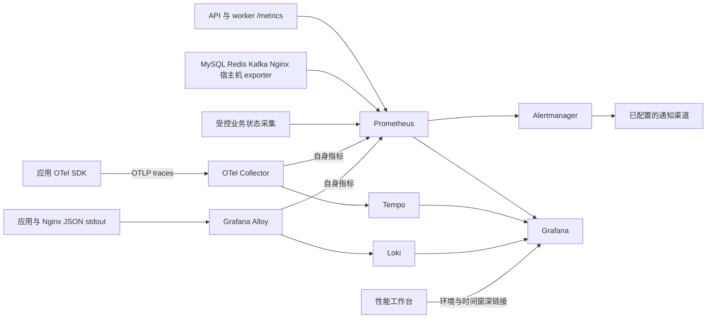
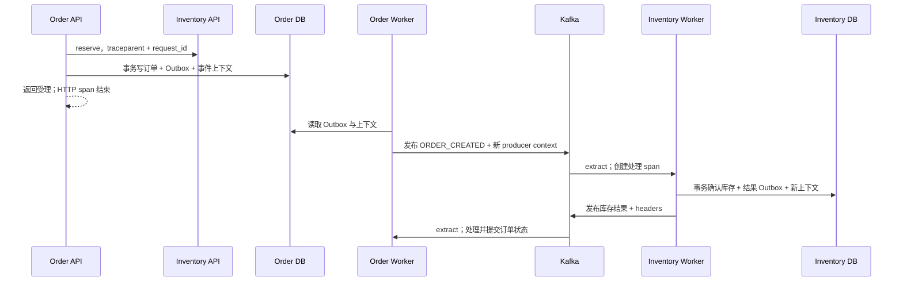

# 秒杀系统 Metrics / Trace / Log 设计与实施方案

设计日期：2026-10-02。范围：当前工作区四个 Python 服务、两个独立 worker、Nginx、MySQL 主从、Redis、Kafka、ShardingSphere、性能平台和现有监控配置。

2026-10-02 设计调查进行了源码、部署配置与历史报告审查，未启动环境、运行压测或重新验证历史故障。2026-10-03 已完成 P0、P1、P2、P3 开发及本地部署验证，详见 [P0 运行说明](observability/p0.md) 与 [P1 运行说明](observability/p1.md)，以及 [P2 运行说明](observability/p2.md)；P3 详见 [运行说明](observability/p3.md)，P4 仍为实施设计。

前端业务边界：沿用现有网页工程与外壳，侧边栏提供独立的「压测」「监控」「Trace」业务页面。实时监控与链路查询不依赖压测 run；压测详情仅保留该次任务的历史指标快照。

## 1. 设计结论

2026-10-03 补充产品约束：可观测能力统一在现有 `performance/web` 压测平台 UI 中开发，复用运行列表、详情视角、环境与时间上下文。不新增独立可观测前端，不与 `frontend` 秒杀商城共享前端。Grafana 等作为监控基础设施与可选深入查询入口；平台内的状态、后续追踪和日志交互由压测控制器的受控只读 API 支持。

采用 **Prometheus + Alertmanager + OpenTelemetry Collector + Tempo + Loki + Grafana**。应用指标继续使用现有 prometheus-client，追踪使用 OpenTelemetry Python SDK，日志统一输出 JSON，由 Grafana Alloy 采集容器日志送入 Loki。避免同时用两套 SDK 记录同一 HTTP 指标。

首期在现有 Compose 上完成真实业务链路与故障闭环，同时为跨主机部署保留资源标识、采集协议、存储和服务发现边界。单机验证与生产部署分别验收；部署一组容器只能证明功能集成，不能证明高可用或生产容量。

优先回答以下问题：

1. 哪个服务、实例、接口或后台线程正在出问题？
2. 延迟消耗在连接池等待、SQL、Redis Lua、库存 HTTP、Outbox 等待还是 Kafka 消费？
3. 请求受理后，订单是否最终确认？失败是正常售罄、业务冲突还是系统异常？
4. worker 容器还在运行时，关键发布或消费线程是否已经退出？
5. 库存与订单是否在约定时间内收敛？采集失败时，界面是否明确显示证据缺失？
6. 能否从指标异常跳到对应 trace，再跳到日志，找到同一订单的异步处理记录？

## 2. 代码库调查结果

### 2.1 实际架构

| 组件 | 代码与配置事实 | 设计影响 |
|---|---|---|
| 用户服务 | FastAPI、SQLAlchemy/PyMySQL、JWT、头像上传；main.py 仅有 HTTP 指标中间件 | 补齐统一日志和上下文；登录凭据、上传内容不得进入遥测 |
| 商品服务 | 两个容器，每个 Uvicorn 4 进程；Redis 缓存、锁、主从读和回退；已有 Prometheus multiprocess 汇总 | SDK 按进程初始化；保留多进程计数正确性；不能随意切换部署模式 |
| 订单 API | httpx 同步调用库存，然后写订单及 Outbox；支付请求也写 Outbox | 单次 HTTP 请求仅覆盖前半段；落库时持久化追踪上下文 |
| 订单 worker | 一个独立进程内有发布、库存结果消费、支付消费三个线程 | 必须有独立指标端口及线程健康信号；API /metrics 无法汇总它 |
| 库存 API | Redis Lua 预扣，再写 MySQL 预留；支持取消与同步确认 | 库存拒绝、补偿和依赖错误分别记录；Redis 与 DB 的耗时需拆分 |
| 库存 worker | 发布线程与订单消息消费线程；确认预留后写结果 Outbox | 形成第二次持久化上下文边界；异步重试不能依赖线程内存 |
| 数据库代理 | 订单两个逻辑库、每类订单表两张分表；实际共享 mysql-primary | Python SQL span 只看到代理调用，不能据此宣称已看到物理分片执行 |
| 网关 | Nginx 转发四类 API；当前没有 JSON access log 和统一 request ID 配置 | 首期建立入口日志及 request ID；网关 span 可后续按镜像兼容性接入 |
| 现有监控 | monitoring profile 下 Prometheus、Grafana、基础设施 exporter、cAdvisor、business-exporter | 复用监控资产，补充 worker、采集系统与告警路由 |

主要证据入口：

- [部署定义](../docker-compose.yml)、[网关配置](../nginx.conf)。
- [订单服务及 worker 实现](../order_service/app/application/services/order_service.py)、[订单 Outbox 模型](../order_service/app/models/order.py)。
- [库存服务及 worker 实现](../inventory_service/app/services/inventory_service.py)、[库存模型](../inventory_service/app/models/inventory.py)。
- [商品多进程启动](../product_service/Dockerfile)、[商品指标注册](../product_service/app/observability/metrics.py)、[数据库读回退](../product_service/app/infrastructure/database/product_repository.py)。
- [Prometheus 采集](../performance/monitoring/prometheus/prometheus.yml)、[现有规则](../performance/monitoring/prometheus/rules/performance.yml)、[性能业务采集器](../performance/monitoring/business-exporter/collector.py)。

### 2.2 现有可观测性缺口

| 缺口 | 代码中的具体表现 | 要完成的改造 |
|---|---|---|
| 没有分布式追踪 | requirements 未包含 OTel；HTTP 与 Kafka 客户端没有业务追踪集成；Outbox 没有 context 字段 | 自动依赖埋点 + 业务 span + HTTP/Kafka 传播 + Outbox 元数据迁移 |
| 请求 ID 未贯穿业务 | 三个服务把 ID 放 request.state，业务日志没有自动注入；httpx 没有显式传递 | 用 ContextVar 及 logging filter 注入；HTTP 客户端继续传递 request ID |
| 用户日志规范不同 | 用户服务没有另三个服务的 JSON formatter | 统一初始化接口与 schema；覆盖 Uvicorn、应用和 worker 日志 |
| 日志字段被丢弃 | formatter 使用字段白名单；订单日志中的 order_status、payment_status 不在白名单 | 显式 schema 覆盖状态、事件、重试和消息定位字段 |
| 路由标签可能高基数 | HTTP 中间件没有匹配路由时回退 request.url.path | 未匹配统一为 __unmatched__；方法也限制在允许集合 |
| 指标口径不完整 | inventory_reservations_total 只在成功返回前增加；商品 DB 计数是查询操作，不是实际主从 SQL 次数 | 增加所有 outcome；DB 回退、SQL 次数和池等待独立计量 |
| worker 是盲区 | Prometheus 不抓两个 worker，worker 没有指标服务；线程没有健康监督 | 独立 :9106/metrics，按任务角色记录线程健康与循环进度 |
| 业务采集是压测专用 | business-exporter 按固定商品和用户段扫描物理分表，使用 root，每 5 秒执行多次聚合 | 保留压测用途；新增生产读权限、受控扫描、采集新鲜度和预算 |
| 告警无法交付闭环 | 只有全局 5xx、全局 Kafka lag 两条规则；Compose 无 Alertmanager | 服务级 SLO、异步/一致性告警、分组抑制、路由和 runbook |
| 仪表盘可能误判 | 4xx+5xx 统一显示错误；各服务 RPS 相加会重复计算同一业务请求 | 分开入口流量、内部流量、业务拒绝和系统失败 |

### 2.3 历史故障对设计的约束

[2026-09-30 压测报告](../performance/reports/20260930-full-test-analysis.md)记录：1,000 用户争抢中有 102 个 500，主库连接耗尽，库存 Outbox 发布线程退出，库存结果消息积压；库存 reserved=-96，库存总量为 99，有效订单数为 0。

这些是历史报告中的观测，不是本次重现结果。连接耗尽和线程退出有日志证据；库存并发更新问题在报告中仍属于待定位原因。因此首期必须提供连接池、线程健康、待处理最老年龄、状态收敛与库存守恒证据，不能只部署 UI 或查询数据库最终数量。

## 3. 采集与存储架构

首期 Prometheus 是应用指标的唯一采集入口，不让 Collector 重复抓取同一端点。Alloy 负责容器日志，Collector 负责 traces，两者各自拥有独立的队列、资源限额与健康监控。

首期新增 docker-compose.observability.yml 作为根 Compose 的覆盖文件，复用原 monitoring profile 与已有 Prometheus/Grafana。生产配置放 infra/observability；performance/monitoring 逐步成为性能环境入口，不直接把压测专属数据当生产状态。

本地 Tempo/Loki 可使用持久卷，生产使用兼容对象存储及按产品支持方式部署的多副本读写组件。Prometheus 首期本地持久存储；跨主机阶段按实际长周期查询需求选择 Thanos 或 Mimir 中一种，不同时引入。首期不新增 Elasticsearch 集群，因为当前主要需求是按服务、时间、trace 和订单关联日志，Loki 能覆盖；复杂全文分析有真实需求后再评估。

Docker Desktop 下必须实际验证 Alloy 对 Docker 容器日志的读取与轮转续读，不能假定 Windows 宿主存在 Linux 日志文件路径。Docker API 采集应使用限制权限的代理或隔离采集器；不能把挂载 docker.sock 的 :ro 当作 API 只读授权。

## 4. 统一资源与上下文契约

统一资源字段：service.namespace=seckill，service.name，service.version，deployment.environment.name，service.instance.id。Prometheus 对应 namespace、service、environment 等标签；Grafana 查询配置显式做字段映射。

建议逻辑名称为 user、product、order-api、order-worker、inventory-api、inventory-worker。原指标 service=order/inventory 等值先保持兼容，新逻辑名称由 target/resource 标签补充，后续通过版本化 recording rules 迁移。

service.instance.id 由容器/部署实例生成；商品多进程 trace 额外记录 process.pid。版本使用构建时的 Git SHA；环境配置与压测模式单独记录，不能把每次发布生成的版本值附加到每一个高流量 metric 上。

| 标识 | 作用 | 使用位置 |
|---|---|---|
| request_id | 一次 HTTP 请求及同步下游的日志关联 | 响应头、应用日志、网关日志、span 属性 |
| trace_id / span_id | 分布式调用关联 | trace、JSON 日志、可用时的 histogram exemplar |
| event_id | 一条逻辑事件的稳定身份 | Outbox 元数据、Kafka header、日志、span |
| order_id | 跨多次 HTTP 与异步链路的业务身份 | 日志字段、受控 trace 属性；不作为指标标签 |
| test_run_id | 隔离压测运行关联 | 日志、span、报告；不作为默认 metric 或 Loki 索引标签 |

W3C traceparent/tracestate 作为传播协议；request ID 与 trace ID 保持独立。对外部 header 校验格式和长度，不直接信任客户端的采样指令；未授权 baggage 默认丢弃。压测 run ID 只允许由可信本地控制器注入。

HTTP 中间件用 ContextVar 建立 request 上下文，logging filter 自动注入，finally 中清理；验证 FastAPI 同步线程池的上下文传播。后台线程不继承某次请求的隐式上下文，每条消息显式 extract/attach/detach，异常时也必须清理，防止订单之间串链。

## 5. Metrics 设计

### 5.1 四个观测层面

| 层面 | 必要指标 | 口径 |
|---|---|---|
| API 与入口 | HTTP requests、duration、inflight；Nginx upstream 时间和入口状态 | method、路由模板、状态；网关请求量与内部服务调用量分别展示 |
| 依赖与资源 | SQL duration、pool checkout wait/timeout、checked-out/overflow；Redis 命令/Lua、HTTP client duration；容器/宿主机资源 | 只用固定 db_role、operation、dependency 等维度 |
| 异步任务 | 发布成功/失败、consumer 处理结果/耗时、commit 失败、重复消息、Outbox backlog/age、线程健康 | 以 topic、consumer group、event_type、worker role 定位 |
| 业务一致性 | 受理、确认、失败、支付状态转移；待确认/待支付最老年龄；库存不变量与对账差异 | 按真实状态和事务提交计量，正常拒绝与系统故障分离 |

候选新增指标如下，精确名称在实施时固定到指标目录与 dashboard 契约：

| 指标 | 类型 | 有限标签 |
|---|---|---|
| seckill_submission_total | Counter | outcome=accepted/sold_out/duplicate/invalid/system_error |
| order_state_transitions_total | Counter | from、to、reason（枚举） |
| order_confirmation_duration_seconds | Histogram | outcome |
| inventory_operation_total | Counter | operation=reserve/confirm/cancel、outcome |
| outbox_publish_total | Counter | event_type、outcome |
| outbox_pending_events | Gauge | owner、event_type |
| outbox_oldest_pending_age_seconds | Gauge | owner、event_type |
| consumer_process_total | Counter | topic、group、outcome |
| consumer_process_duration_seconds | Histogram | topic、group |
| consumer_commit_failures_total | Counter | topic、group |
| worker_task_alive | Gauge | role |
| worker_loop_last_progress_timestamp_seconds | Gauge | role |
| db_pool_checkout_wait_seconds | Histogram | db_role |
| db_pool_timeouts_total | Counter | db_role |
| product_read_fallback_total | Counter | reason（枚举） |
| business_reconciliation_violations | Gauge | invariant（枚举） |
| business_collector_last_success_timestamp_seconds | Gauge | collector |

库级依赖 span 不能代替池等待指标：SQL 执行计时未必覆盖获取连接。池 checkout 等待需围绕真实连接获取路径计时，并验证与 SQL 执行 span 的边界。

指标更新规则：状态迁移成功提交后增加 transition counter；幂等重复消费不再增加真实迁移次数，增加 duplicate 结果。进程重启后 Counter 重置由 rate/increase 处理。实时 Counter 用于趋势，持久账本及状态采集才是业务数量的权威来源；不能承诺进程内 Counter 提供事务级精确计费。

端到端确认耗时从订单 accepted 的持久时间算到 CREATED/FAILED 的首次终态提交，不能将 HTTP duration 或 consumer duration 直接当作最终确认延迟。待处理订单尚未完成时不会进入完成直方图，必须同时展示超时待处理 Gauge/账本统计，避免幸存者偏差。

### 5.2 多进程与 worker

商品服务保留现有 multiprocess 机制，启动时清理该容器自己的临时目录；按 Gauge 的语义明确 liveall/livesum 等模式，验证子进程退出后的数据清理。多进程模式下不默认承诺支持 exemplars 或所有默认 process 指标；首期以容器指标补充资源观测，exemplar 功能按实际库兼容性验收。

订单与库存 worker 各自在进程内启动独立 Prometheus HTTP server，建议端口 9106，仅容器网络开放。新采集 job 为 order_worker、inventory_worker。thread alive 与有效循环进度分别记录，空闲消费者不能因没有业务消息而触发失活告警；必要时使用有超时的 poll，让线程能报告健康轮询。

线程包装器捕获未处理异常、记录堆栈、置零对应 alive，并使 worker 进入明确不健康状态。自动重启/重试属于另一个明确的可靠性变更，需与幂等和退避共同设计，不能仅用监控装饰器吞掉异常。

### 5.3 基数与采集开销

禁止 user_id、order_id、request_id、trace_id、原始 URL、Redis key、自由文本异常进入 metric labels。允许 path 路由模板和固定 outcome；无匹配路由统一 __unmatched__，动态下游 error_code 映射到固定集合，未知为 other。

生产默认抓取 15 秒、规则 30 秒；关键任务可 10 秒；压测保留 5 秒。目标活跃序列数按路由 × 方法 × 状态 × 实例 × histogram 桶数估算并设预算。为秒杀同步耗时和异步完成耗时分别配置桶，覆盖拟定 SLO 边界，不仅使用默认桶。

业务聚合不在 /metrics 抓取过程中执行跨分片大查询。新增受控后台状态采集器，按 30–60 秒受索引支持的窗口/分片扫描，限制超时和并发；暴露上次成功时间、耗时、错误与扫描覆盖。历史及全量对账另设低频任务。采集失败保留最后成功值并明确标识过期，禁止把失败写成零。

扫描订单 Outbox 的生产查询不能依赖 JOIN 到现存订单才能纳入统计，否则会漏掉孤立事件；扫描所有待处理事件并单独检查孤立关系。变更索引前以执行计划和代表数据验证，防止监控本身加重连接耗尽。

库存守恒以权威库存账本及盘点/调整历史为基线，按 quantity 汇总。现有 sold == valid_orders 的单件测试条件不能泛化到多件订单，也不能把生产库存总量固定为测试初始库存 100。

## 6. Trace 设计

### 6.1 依赖埋点与业务 span

FastAPI、httpx、SQLAlchemy、Redis 使用兼容版本的 OTel instrumentation；kafka-python 有官方 contrib 集成，但项目的 Outbox、线程边界与业务处理 span 仍需手工实现并验证。避免自动 producer span 与手工发送 span 重复计量。参考 [Python instrumentation libraries](https://opentelemetry.io/docs/languages/python/libraries/) 与 [kafka-python instrumentation](https://opentelemetry-python-contrib.readthedocs.io/en/latest/instrumentation/kafka_python/kafka_python.html)。

核心业务 span 建议：order.submit、inventory.reserve、inventory.redis_reserve、order.persist_with_outbox、inventory.cancel、outbox.publish、inventory.confirm、order.apply_inventory_result、payment.request、payment.apply_result。

SQL 捕获策略默认不记录带值 SQL、参数、数据库 URL 密码；Redis 不记录原始 key 和 value；HTTP 不采集 JWT、Cookie、请求体或查询串。HTTP 409 售罄是业务拒绝，business.outcome=sold_out，不默认标记为系统 ERROR；数据库异常、调用超时和发布失败记录 ERROR 及脱敏异常。

SQLAlchemy 对 order_engine 的 span 到 ShardingSphere Proxy 为止。代理内部路由与物理 SQL 首期通过代理/JVM 指标、日志和 MySQL 证据辅助判断；进一步接入代理追踪必须独立验证版本、插件和传播机制，不伪造物理分片 span。

### 6.2 持久化异步上下文

在两种 Outbox 中新增可空、向前兼容的字段或单个受限 JSON 元数据列，包含 event_id、traceparent、tracestate、request_id、可信 test_run_id、schema_version。与业务记录同事务写入；订单分片的所有物理 Outbox 表都需迁移。不把 trace 信息写进业务主键，也不为它新增高频数据库索引。

event_id 使用独立生成的稳定 ID，重试保持不变；库存结果是新的事件，有新的 event_id 和 causation_id 指向触发事件。每次发送有独立 attempt span，通过 Kafka headers 传播本次 producer 的上下文。发送重试时不能重用同一 span_id。

对正常短时异步，恢复持久化的 parent context，使 API、发布和消费在同一 trace 中。消费处理 span 必须覆盖业务处理及 offset commit，不能仅覆盖 poll/迭代。库存结果 Outbox 保存当次库存处理上下文，形成第二段传播。

历史 Outbox 无上下文时新建 trace，并保留 order_id/event_id 业务关联。人工重放或长时间延迟重试建立新 trace，用 Span Link 关联原始上下文，避免无限延长一条 trace。支付是用户之后发起的独立请求，建立独立 trace，通过 order_id 关联订单生命周期；不会硬接到已结束的下单 span。

先验收重启发布器后仍能关联上下文，再讨论采样与成本。仅在 Kafka send 时从当前线程取上下文，无法实现 Outbox 场景的可靠传播。

### 6.3 采样与长时异步

本地功能验收全量采样；生产头采样为受控比例并保持父子决定一致。若需要对到达 Collector 的错误/慢 trace 做尾采样，需要所有相关 spans 到达同一采样实例；生产扩容使用 trace ID 路由。头采样丢掉的数据不能被尾采样找回。[OTel sampling](https://opentelemetry.io/docs/concepts/sampling/)、[Collector gateway pattern](https://opentelemetry.io/docs/collector/deploy/gateway/)。

正常异步链路按实测确认时延设 decision_wait；超出窗口的消息、尾采样 decision cache 和晚到 span 明确验收，不能承诺任意延迟异步都能全链完整。长期重试采用独立 trace + link，并保留持久事件日志、积压与超时指标作为完整业务证据。

错误保留策略只对采集且到达的 traces 生效；设置总量和内存预算，观测尾采样丢弃、队列与晚到 span。不能在高压下无预算地开启全部 SDK spans 再声称错误全保留。

## 7. Log 设计

应用统一单行 JSON 输出 stdout。字段包括 timestamp（UTC）、severity、service、environment、version、instance、logger、event、message、request_id、trace_id、span_id、order_id、event_id、causation_id、topic、partition、offset、group、attempt、outcome、error_code、exception，以及有关状态迁移字段。

使用固定 event 名称，例如 seckill.accepted、inventory.reserved、outbox.publish_failed、consumer.process_failed、worker.task_exited、order.state_changed。HTTP access 记录 route_template，原始 path 如有必要需脱敏；异常堆栈放入 JSON 字符串，防止多行拆散。

业务状态迁移、发布失败、补偿失败与 worker 退出日志优先保留。热点成功读、/metrics、健康检查日志可降级或按比例采样。重复售罄属于业务结果，不逐条 ERROR 输出。日志采样不会改变不采样的业务 metrics；受采样的请求即使有 trace_id，也可能没有对应已保存 trace，UI 要显示明确查询结果。

Loki 索引标签限定 environment、namespace、service、level 等有限维度。trace_id、order_id、request_id、run_id 等放结构化元数据或 JSON 字段，通过服务与时间范围缩小查询；禁止为每笔订单建一个日志流。参考 [Loki label best practices](https://grafana.com/docs/loki/latest/get-started/labels/bp-labels/) 与 [structured metadata](https://grafana.com/docs/loki/latest/get-started/labels/structured-metadata/)。

JWT、密码、邮箱、手机号、支付敏感信息与完整请求/响应体默认禁止记录。user_id 根据用途采用伪名化并限制访问；order_id 检索权限、日志保留与导出权限有明确边界。应用先脱敏，采集端再做兜底；遥测库不是资金审计账本。

Nginx 配置 escape=json 的 access log，记录入口 request ID、请求时间、上游地址/状态/耗时。入口生成可信 request ID 并传下游；校验后透传 W3C trace headers。首期从应用创建 server span，网关日志通过 request ID 关联。要从 Nginx 日志直接跳同一 trace，需额外返回安全的 trace 标识或接入经过验证的网关 OTel 模块；首期不假定默认 Nginx 镜像包含该模块。

## 8. SLI、告警与排障闭环

### 8.1 SLI 分层

| SLI | 分子 / 分母或观测对象 | 说明 |
|---|---|---|
| API 系统可用性 | 正确处理的有效请求 / 有效请求 | 售罄与重复为正确业务响应；恶意/无效输入独立统计；5xx 与依赖超时为系统失败 |
| API 时延 | 按接口观察完成时间 | 入口耗时与内部 API 耗时分开；连接拒绝也需入口/探针证据 |
| 异步确认及时性 | 受理 cohort 中截止时限内到达 CREATED/明确业务 FAILED 的数量 / 已到截止时限的受理数量 | 长期 PENDING 算未及时完成；不以“已完成订单”为唯一分母 |
| 业务确认结果 | 库存确认、业务失败、系统失败、待处理 | 成功率与及时性分开，避免把预期业务失败算系统故障 |
| 一致性 | 权威库存及订单/预留关系的不变量 | 负库存立即异常；跨服务差异按收敛窗口和一致读取策略判读 |

首期可以用实验目标验证，例如 API 99.9%、读 p95 100ms、受理 p95 300ms、99% 受理订单在 5 秒内确认；这些是待业务与容量测试校准的目标，不是项目已达到的能力。真实生产 SLO 还需要峰值流量、订单规模、活动时长和通知负责人。

### 8.2 告警与关联证据

| 告警 | 条件方向 | 第一排障证据 |
|---|---|---|
| WorkerTaskDown | 目标存活但关键任务 alive=0；target 缺失另设告警 | worker.task_exited + 对应依赖错误 |
| OutboxDeliveryDelayed | 最老 pending age 超过交付预算并持续 | event_type、发布错误、DB/Kafka spans |
| ConsumerStalled | 有积压且健康 poll/进度停滞 | group/topic/partition、commit 失败、处理异常 |
| DbPoolPressure | 获取连接等待、timeout 增长；DB 连接接近上限 | 各服务池总量、MySQL 1040、慢 SQL |
| InventoryInvariantBroken | available/reserved/sold 任一负数或权威守恒失败 | 对账证据、相关状态迁移和补偿日志 |
| OrderConfirmationDelayed | 待确认最老年龄与超过截止期限数量持续增长 | 两段 Outbox、消费者与库存结果处理 |
| HttpSloBurn | 按服务/接口 SLO 多窗口错误预算消耗 | 系统错误分类 + 依赖延迟/错误 |
| TelemetryPipelineDegraded | Collector/Alloy 队列、丢弃、发送失败、存储异常 | 采集器自身指标与日志 |
| BusinessEvidenceStale | 状态采集失败或超过 freshness 预算 | 扫描错误、权限、超时、覆盖范围 |

告警分组以 environment/service/alertname 为主，按依赖故障做有限抑制；严重性、负责人、dashboard URL、runbook URL 必须齐全。生产可用性采用多窗口 burn rate，单个固定 lag 阈值作为诊断信号而非唯一分页条件。低流量须设置足够样本，并独立处理无数据/target down，不能用 clamp_min 分母掩盖观测缺失。

异步端到端 cohort SLI 首期由账本窗口计算：每个受理订单最多计一次，截止时间到达后再判定。晚确认保留最终结果但不改成“按时完成”。异常中间状态恢复、库存拒绝和系统失败需要有限、稳定原因枚举。

实际邮件、IM 或值班渠道需要配置通知端点与负责人后验收；部署 Alertmanager 不等于通知链已经可用。

## 9. Grafana 与现有性能工作台

交付五组仪表盘：服务/API RED；依赖与数据库连接池；Outbox/Kafka/worker；订单库存一致性；遥测管道自身健康。

配置 Prometheus、Tempo、Loki datasources 的关联：日志 trace_id 跳 Tempo，Tempo span 按 service/time/trace_id 查 Loki，支持条件下 histogram exemplar 跳 trace。业务 order_id 提供限定服务与时间窗的日志检索。

现有性能工作台是可观测能力的统一产品界面。侧栏“压测”“监控”“Trace”“日志”为独立业务页面。监控提供环境指标、worker 任务健康、告警与通知，Trace 和日志独立查询且不依赖压测记录；历史任务快照保留在压测详情中，通过压测控制器的受控只读接口查询，真实外部深链接仅作为补充。遵循仓库 [Style.md](../Style.md) 的能力真实性要求，不伪造 trace、事件或告警，不将 Grafana/Loki/Tempo 管理凭据暴露给浏览器，不开放任意 PromQL/LogQL 代理。

压测报告添加版本、配置快照、采样策略、遥测采集可用性与 Grafana 查询链接。报告是固定证据，链接受后端保留周期限制；关键故障导出脱敏 trace/log 附件并记录范围，避免几天后链接失效导致报告无法复核。

## 10. 故障隔离、容量与生产部署

SDK 使用 BatchSpanProcessor、有界队列和短超时；请求路径不等待 Tempo/Loki 持久化。遥测故障时允许有界丢弃并告警，业务不能因监控不可用而无限阻塞。

Collector 配置 memory_limiter、batch、retry 和持久 sending queue；WAL 挂独立卷并设磁盘预算。WAL 缓解导出队列重启损失，但不等于持久化尾采样所有未决状态，也不能保证磁盘满、队列满、超时后的零丢失。[Collector resiliency](https://opentelemetry.io/docs/collector/resiliency/)。

Alloy 校验日志采集状态持久化、断点恢复、Docker 日志轮转、后端不可用的重试/缓存边界。Docker 日志设 max-size/max-file，告警关注磁盘水位和采集落后。业务与遥测至少设独立 CPU/内存额度；生产部署到独立节点/故障域，避免共享故障令业务和证据同时消失。

初始保留建议为 metrics 15–30 天、trace 3–7 天、日志 7–14 天，生产再按合规与预算调整。成本估算采用实测：

- trace 日量 ≈ 请求数 × 平均 span 数 × 单 span 字节 × 实际保留比例；计入 worker 与重试。
- log 日量 ≈ 每秒日志条数 × 平均字节 × 86400；按存储压缩和复制另算。
- metrics 量按活跃序列数、抓取周期、保留时间与实际 TSDB 压缩估算。
- 采样内存按每秒进入的 trace 数 × decision_wait × 平均暂存字节估算，再留余量。

生产采集入口与存储接口仅私网开放，OTLP 采用认证/TLS，Grafana 接统一登录与角色权限，exporter 使用最小权限账号。镜像和 Python 依赖固定兼容版本，完成组件配置校验再锁定版本，不能继续全部依赖 >= 或浮动镜像。

跨主机阶段使用每节点 Alloy Agent、OTel gateway 多副本，Prometheus 服务发现，按 trace ID 做尾采样路由，Alertmanager 集群，并按容量选择后端高可用与对象存储。业务目前也存在单点，监控高可用不能替代业务高可用。

## 11. 文件改造与实施顺序

共享遥测实现建议作为独立版本化 Python 包，放 packages/seckill-observability，提供 config、context、logging、tracing、metrics_helpers、messaging。只共享机制，不导入业务 DTO、repository 或 settings。四个镜像目前各自以服务目录为 build context，共享包接入需显式调整 Docker COPY/build context，或构建固定版本 wheel；避免宿主可导入而容器构建缺文件。

| 阶段 | 主要改动 | 可评审产物与验收 |
|---|---|---|
| P0 统一契约与补盲 | 共享包；四服务 main/日志；worker 指标端口/线程监督；路由标签归一；保持原 metric 兼容 | 日志 schema、指标目录；并发上下文不串；worker 线程退出能被发现 |
| P1 同步追踪 | requirements 锁版、SDK 初始化；FastAPI/httpx/SQLAlchemy/Redis；order.submit、inventory.reserve；Collector、Tempo | 同一次 HTTP 调用跨 order/inventory 且能定位 SQL/Lua；后端故障不阻塞业务 |
| P2 异步闭环 | 两类 Outbox 元数据及全分片迁移；producer/consumer headers；context 恢复；重试/link；业务状态指标 | API→Outbox→Kafka→库存→结果→订单可追踪；进程重启、重复投递、无上下文旧事件兼容 |
| P3 日志与告警 | Alloy/Loki；Nginx JSON；Alertmanager；仪表盘与 datasources；runbooks；受控业务采集 | 三信号关联；发现连接耗尽、积压、负库存和遥测缺失；测试告警可达 |
| P4 性能与生产验证 | k6/报告关联；冷/热与故障演练；采样/资源预算；HA 部署与保留策略 | 实测开销、故障恢复与成本；同构环境 SLO 与上线门禁 |

计划新增文件包括：

- docker-compose.observability.yml。
- infra/observability/{otel-collector,alloy,tempo,loki,alertmanager}/ 对应配置。
- infra/observability/prometheus/{rules,recording-rules}/ 与 grafana/{dashboards,provisioning}/。
- packages/seckill-observability/ 与版本化依赖锁定。
- infra/mysql/migrations/ 中明确列出全部订单分片与库存表的元数据迁移；迁移不放应用启动 create_all。
- docs/observability/metrics-catalog.md、logging-schema.md、runbooks/、deployment.md。
- tests/observability/ 中上下文传播、日志脱敏、重复消费计数、故障隔离等契约测试。

P0 已实现共享包、上下文/日志、worker 健康、工作台状态 API/UI、根构建上下文与现有 Prometheus 配置扩展。P1 已实现 Collector/Tempo 和同步追踪，P2 已实现 Outbox 全分片迁移及 Kafka 异步追踪闭环。P3 已接入 Alloy/Loki/Alertmanager、工作台持久通知、全环境只读审计和五组看板，生产高可用与外部通知验收尚未完成，实际交付范围以各阶段运行说明为准。

P4 已落地本地隔离验收工具、应用侧重复性能测量与故障恢复证据、SLO 规则及工作台图、报告快照与响应关联、采样/资源预算及生产准备模板。用户确认尚未上线，因此生产 HA、同构容量和外部通知保留为门禁未通过项；性能实测不达标时保留失败证据。详见 docs/observability/p4.md。

## 12. 验收矩阵

| 场景 | 必须观察到的结果 |
|---|---|
| 正常下单与库存确认 | 同步与异步 span 关系正确；最终状态、处理时延与日志可关联 |
| 售罄、重复、参数错误 | business outcome 分类正确；不虚增系统失败；HTTP 原始状态仍可见 |
| 订单落库失败并取消失败 | 原始异常与补偿异常都有证据，保留 order_id；待修复状态能被检测 |
| Redis 故障或商品从库回退 | Redis 错误、回退次数与主库负载变化能对应 |
| DB 连接耗尽 | pool wait/timeout、MySQL 连接压力、1040 日志及受影响服务可定位 |
| Kafka 故障、offset commit 失败 | 发布/处理/commit 失败可区分；重复处理不虚增业务状态迁移 |
| 发布线程退出但容器存活 | 任务健康告警触发，能定位退出堆栈；空闲消费不会误报 |
| Outbox 延迟与 worker 重启 | 上下文随数据恢复；旧事件兼容；积压与最老年龄正确 |
| 长时间重试/人工重放 | 新 trace 链接原 trace；event_id 保持；晚到 span 行为有证据 |
| 库存不守恒或跨服务延迟 | 负数与长期差异触发不同规则；短暂最终一致差异有收敛窗口 |
| 采集器/Tempo/Loki 停机 | 应用继续处理；有界缓存与丢弃可见；恢复行为、丢失范围明确 |
| 随机 404 路径与高并发 | 标签基数有界；上下文不串；日志与 SDK 不泄露秘密 |
| 商品 4 进程重启 | 指标聚合正确，不遗留旧进程 Gauge；各进程 trace exporter 正常 |
| 对账采集失效 | 最后成功值、过期状态与错误同时可见，不显示假零值或假通过 |

在相同负载、配置和数据下比较关闭/开启遥测的 CPU、内存、RPS、p95/p99、日志写入和队列丢弃。初始开销目标可设吞吐下降及 p95 增幅各不超过 5%，实际阈值按环境抖动、峰值与重复实验确定；这是验收目标，不是提前承诺的测试结果。

配置先执行 Compose 渲染、Prometheus/promtool 规则校验、Collector/Alloy 与后端配置校验；规则使用有代表性的序列测试验证服务聚合、低流量、无数据与抑制。故障演练在隔离数据和明确目标环境执行，遵循现有性能平台 ConfirmTarget 边界。

最终交付标准是能发现并解释一次真实故障，关联完整业务阶段，正确区分拒绝、失败、延迟与缺失证据，并证明遥测故障不会拖垮业务。修复库存并发和消息可靠性本身需要独立实现与回归；可观测系统负责提供可验证的定位和结果证据。
